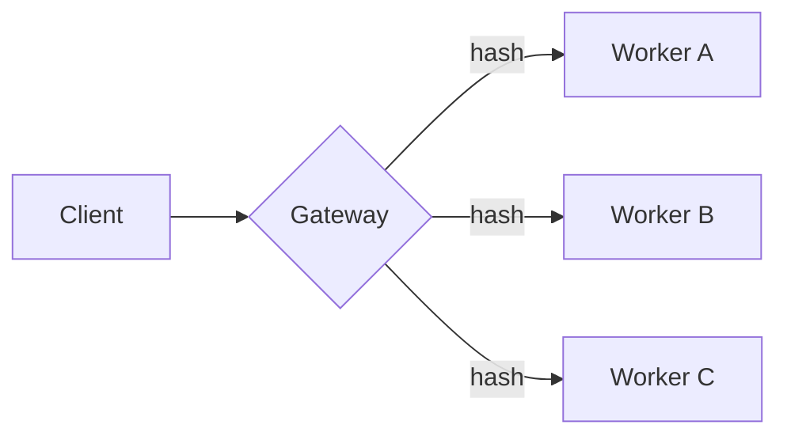

# Request routing

## Overview

The gateway picks a worker by consistent hashing[^ring], so adding a worker moves only about $\frac{1}{n}$ of the keys. With $n$ workers and $k$ keys, the expected load per worker is

$$
\mathbb{E}[L] = \frac{k}{n}, \qquad \sigma_L = \sqrt{\frac{k}{n}\left(1 - \frac{1}{n}\right)}
$$



## Lookup

```python
from bisect import bisect

def worker_for(ring, key):
    """The first worker clockwise from the key's hash."""
    points = [point for point, _ in ring]
    index = bisect(points, hash(key)) % len(ring)
    return ring[index][1]
```

## Checklist

- [x] Hash ring with virtual nodes
- [x] Health checks every 2 s
- [ ] Weighted workers

[^ring]: Karger et al., *Consistent Hashing and Random Trees*, 1997.
